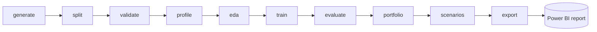

<div align="center">

# 🏦 Credit Risk Modelling & Portfolio Stress Testing Engine

**An end-to-end credit risk analytics prototype for a fictional UK retail bank:**
synthetic data → PD modelling → validation → expected loss → hypothetical stress tests → Power BI


</div>

> [!IMPORTANT]
> **Please read first**
> - **All data is synthetic.** Nothing here is real customer data, real UK population data or a market statistic. *Northbridge Bank* is fictional.
> - This is a simplified teaching and portfolio prototype. It is **not** suitable for real lending, provisioning or capital decisions.
> - Stress results are **hypothetical what-if exercises**, not forecasts.
> - Developed as an independent portfolio project **with AI assistance**: Claude (Anthropic) assisted with the Python implementation and analysis, and AI guidance supports the Power BI build. The project owner reviews and approves design decisions and is responsible for the work.
> - It is not affiliated with Barclays or any other bank.

**Project status:** the Python pipeline, documentation, automated tests and three-page Power BI report are complete. The report file is [`Credit_Risk_Stress_Testing.pbix`](Credit_Risk_Stress_Testing.pbix) in the repository root. The dashboard is an analytical portfolio demonstration, not a production banking system.

## Contents

[Overview](#-overview) · [Dashboard preview](#-dashboard-preview) · [Headline results](#-headline-results) · [Workflow](#-workflow) · [Quick start](#-quick-start) · [Running the pipeline](#-running-the-pipeline) · [Repository structure](#-repository-structure) · [Power BI report](#-power-bi-report) · [Key outputs](#-key-outputs) · [Reproducibility and verification](#-reproducibility-and-verification) · [Limitations](#-limitations) · [Documentation](#-documentation)

## 🎯 Overview

Northbridge Bank holds a portfolio of unsecured personal loans. This project builds the analytical workflow a risk team would use to understand that book, end to end and reproducibly.

| | |
| --- | --- |
| **Portfolio** | 10,000 customers, 15,000 loans, 12-month default horizon from 31 Dec 2023 |
| **Models** | Logistic regression baseline and one gradient-boosting challenger, compared on criteria fixed before fitting |
| **Validation** | Customer-grouped split, grouped cross-validation, calibration, customer-level cluster bootstrap, segment stability, paired model comparison |
| **Risk measures** | PD, EAD, LGD (flat 70%, a synthetic assumption) and illustrative expected loss |
| **Stress testing** | Baseline, adverse and severe-adverse scenarios plus a shock-severity sensitivity check |
| **Reporting** | Stable, contract-checked tables feeding a three-page Power BI report |
| **Quality** | 73 automated tests, pinned dependencies, seeded and byte-reproducible runs |

What the pipeline does, step by step:

1. **Generates** a documented, seeded synthetic loan book (`config/config.toml`).
2. **Validates** it with integrity, chronology, leakage and reproducibility checks.
3. **Splits** loans into development (75%) and held-out test (25%) sets so that no customer appears on both sides.
4. **Models** PD with a logistic baseline and a gradient-boosting challenger.
5. **Evaluates** discrimination, probability accuracy and calibration with confidence intervals.
6. **Aggregates** PD, EAD, LGD and expected loss to portfolio and segment level.
7. **Stresses** the portfolio under hypothetical income and debt shocks.
8. **Exports** stable reporting tables, with a contract check, for Power BI.

## 🖼️ Dashboard preview

GitHub cannot display `.pbix` files as interactive dashboards, so screenshots of the three report pages are shown below. To explore the report itself, download [`Credit_Risk_Stress_Testing.pbix`](Credit_Risk_Stress_Testing.pbix) and open it in Power BI Desktop.

**Page 1: Portfolio Risk Overview**


**Page 2: Model Performance & Validation**


**Page 3: Stress Testing (all results hypothetical)**


> [!NOTE]
> The screenshots were taken from the report built on the compact sample tables in `data/sample/reporting/` (for example, 150 loans on page 1). Full-portfolio reference values are listed in [`docs/reporting_tables.md`](docs/reporting_tables.md).

## 📈 Headline results

Reference run (seed `20261002`, pinned library versions). All figures come from synthetic data and are reproduced by the pipeline.

| Area | Result |
| --- | --- |
| Default rate | 6.08% over the horizon (a 6.0% simulation target) |
| Logistic regression, held-out test AUC | 0.865 (95% interval 0.839 to 0.889) |
| Gradient-boosting challenger, test AUC | 0.836 (95% interval 0.804 to 0.867) |
| Model selection | Challenger fails the pre-agreed criteria on log-loss consistency, size of improvement and AUC, so **logistic regression stays** |
| Calibration (logistic, test) | Slope 1.03; mean predicted PD / observed rate 1.05 |
| Baseline expected loss | GBP 5.12m (5.42% of EAD of GBP 94.3m) |
| Adverse scenario (income −5%, debt +10%) | GBP 5.92m (+15.7%) |
| Severe adverse (income −12%, debt +25%) | GBP 7.37m (+43.9%) |
| Sensitivity (0.5× to 3.0× the severe shock) | Expected loss 1.19× to 3.15× baseline |

> [!WARNING]
> The simulated signal is stronger than originally planned (the oracle AUC is 0.867, above the 0.65 to 0.85 diagnostic band). The deviation was investigated, accepted and documented. Model scores here are **not** typical of real retail credit. Stress results are the model's response on synthetic data, not forecasts. See [`docs/limitations.md`](docs/limitations.md).

## 🔄 Workflow



## 🚀 Quick start

Requires Python 3.11 or later (verified on Python 3.12.3).

```bash
python -m venv .venv
# Windows: .venv\Scripts\activate      macOS/Linux: source .venv/bin/activate
pip install -r requirements-dev.txt     # runtime dependencies plus pytest
python -m pytest                        # 73 tests
python run_pipeline.py --stage all      # generate, model, stress test and export
```

Use `pip install -r requirements.txt` instead if you only want to run the pipeline.

**Pinned versions** (`requirements.txt`): NumPy 2.4.4, pandas 3.0.2, SciPy 1.17.1, scikit-learn 1.8.0, matplotlib 3.10.8. Test dependency (`requirements-dev.txt`): pytest 9.1.1. The pins matter: the gradient-boosting challenger's figures change with the scikit-learn version, so use these versions to reproduce the documented results exactly. No SQL or other infrastructure is used.

## ⚙️ Running the pipeline

Run from the repository root. Stages run in the order below.

| Stage | Command | What it does | Main outputs |
| --- | --- | --- | --- |
| generate | `python run_pipeline.py --stage generate` | Generates data and the small sample | `data/raw`, `data/audit`, `data/processed/loan_analysis_base.csv`, `data/sample` |
| split | `... --stage split` | Customer-grouped dev/test split with three checks | `data/processed/loan_split.csv` |
| validate | `... --stage validate` | Data-quality checks, oracle diagnostics, reproducibility check | `outputs/validation_summary.csv` |
| profile | `... --stage profile` | Distribution and relationship profile | `outputs/data_profile.md`, `outputs/figures/` |
| eda | `... --stage eda` | Development-only collinearity, skew and missingness checks | `outputs/eda_dev_checks.csv` |
| train | `... --stage train` | Cross-validation, selection criteria, refit, test metrics | `models/`, `outputs/model_selection.csv`, `model_metrics.csv`, `model_coefficients.csv`, `data/processed/model_predictions.csv` |
| evaluate | `... --stage evaluate` | Calibration bins, segment stability, paired comparison | `outputs/calibration_bins.csv`, `segment_performance.csv`, `metric_definitions.csv` (and paired rows in `model_metrics.csv`) |
| portfolio | `... --stage portfolio` | Baseline PD, EAD, LGD, EL and reconciliation | `outputs/loan_predictions.csv` |
| scenarios | `... --stage scenarios` | Stress scenarios and sensitivity | `outputs/scenario_assumptions.csv`, `scenario_results.csv`, `sensitivity_results.csv`, `portfolio_summary.csv` |
| export | `... --stage export` | Verifies the reporting-table contract, then writes compact verified samples | `data/sample/reporting/*_sample.csv` (raises on failure) |
| all | `python run_pipeline.py --stage all` | All stages in the order above | all of the above |

> [!TIP]
> **Re-running after a change.** Stage outputs depend on each other. After changing anything upstream, re-run from that stage onward in the order above. In particular, after `train` re-run `evaluate`, `portfolio`, `scenarios` and `export`. `portfolio_summary.csv` belongs to the `scenarios` stage: the `portfolio` stage creates a baseline-only file only if none exists and never overwrites it. The `export` stage fails with an explanatory message if the tables are inconsistent.

## 🗂️ Repository structure

```
.
├── README.md
├── Credit_Risk_Stress_Testing.pbix   # completed three-page Power BI report
├── dashboard screenshots/            # screenshots of the three report pages
├── run_pipeline.py                   # single entry point (stages listed above)
├── requirements.txt                  # runtime dependencies, exact versions
├── requirements-dev.txt              # runtime dependencies plus pytest
├── config/
│   ├── config.toml                   # seed, data-generation, model, evaluation and portfolio settings
│   └── scenarios.toml                # stress scenarios and sensitivity multipliers
├── src/
│   ├── generate_data.py              # synthetic data generator
│   ├── validate_data.py              # data-quality, leakage, reproducibility and oracle checks
│   ├── profile_data.py               # data profile for review (tables and figures)
│   ├── data_split.py                 # customer-grouped dev/test split and split checks
│   ├── features.py                   # leakage-guarded features and model pipelines
│   ├── eda.py                        # compact development-only exploratory checks
│   ├── train.py                      # cross-validation, model selection, refit, test metrics
│   ├── evaluate.py                   # metrics, bootstrap, calibration, segments, paired comparison
│   ├── portfolio.py                  # PD, EAD, LGD, EL, risk bands, aggregation, reconciliation
│   ├── scenarios.py                  # stress scenarios and sensitivity
│   └── export_reporting.py           # reporting-table contract check for Power BI
├── tests/                            # pytest suites: data generation, validation, features/split/evaluation,
│                                     #   model selection, portfolio, scenarios
├── docs/
│   ├── methodology.md
│   ├── limitations.md
│   ├── data_dictionary.md
│   ├── reporting_tables.md
│   └── interview_notes.md            # technical interview preparation notes
├── data/
│   ├── raw/                          # generated customer and loan data (git-ignored)
│   ├── audit/                        # hidden generation variables, never used for modelling (git-ignored)
│   ├── processed/                    # joined table, split labels, model predictions (git-ignored)
│   └── sample/                       # tracked samples: raw data for the first 100 customers (and all their loans);
│                                     #   reporting/ holds compact samples of the reporting tables
├── models/                           # fitted pipelines (git-ignored)
└── outputs/                          # profile, validation, model, portfolio, scenario and reporting tables
```

## 📊 Power BI report

The report is the Power BI file [`Credit_Risk_Stress_Testing.pbix`](Credit_Risk_Stress_Testing.pbix) in the repository root, next to this README. It has three pages:

| Page | Focus |
| --- | --- |
| **Portfolio Risk Overview** | Loans, EAD, expected loss, PD and EL rate; risk-band, purpose and regional views |
| **Model Performance & Validation** | Logistic versus challenger on the test set, calibration, segment AUCs, coefficients |
| **Stress Testing** | Baseline versus adverse and severe-adverse expected loss, sensitivity to shock severity, risk-band distribution, scenario assumptions. All results are hypothetical |

[`docs/reporting_tables.md`](docs/reporting_tables.md) documents the reporting tables, relationships, measures, labelling and reconciliation guidance. The tracked files in `data/sample/reporting/` are compact samples; the full reporting tables are generated locally by the pipeline and are intentionally excluded from Git.

## 📦 Key outputs

| Output | Purpose |
| --- | --- |
| `outputs/loan_predictions.csv` | One row per loan: baseline PD, risk band, EAD, LGD, EL, observed outcome, segments |
| `outputs/portfolio_summary.csv` | Portfolio and segment aggregates for baseline, adverse and severe adverse |
| `outputs/scenario_results.csv`, `scenario_assumptions.csv`, `sensitivity_results.csv` | Hypothetical stress results and their assumptions |
| `outputs/model_metrics.csv`, `calibration_bins.csv`, `segment_performance.csv`, `model_coefficients.csv`, `metric_definitions.csv` | Model evidence |
| `outputs/validation_summary.csv`, `data_profile.md` | Data quality and review |

Column-level definitions are in [`docs/data_dictionary.md`](docs/data_dictionary.md); table relationships and Power BI guidance are in [`docs/reporting_tables.md`](docs/reporting_tables.md).

## 🔁 Reproducibility and verification

One fixed master seed (`20261002`, set in `config/config.toml` and approved by the project owner) feeds independent random streams for customers, loans, outcomes, missingness, splits, cross-validation and the bootstrap. The seed was chosen once, not searched for. The `validate` stage regenerates the data in a temporary folder and compares file hashes with the files on disk. Generated data and the full-size reporting tables are git-ignored and regenerated from configuration; compact verified samples are tracked in `data/sample/`.

**Verification.** Final testing was run in clean virtual environments from a clean checkout. The complete test suite passed (**73 tests**), `python run_pipeline.py --stage all` and the reporting export checks completed without errors, and regeneration reproduced identical file hashes. Validation reported no failures; the two `REVIEW` items are accepted oracle diagnostics documented in the project limitations. With the pinned library versions, generated outputs, including challenger results and reporting samples, were byte-identical across runs. The environment verified was Python 3.12.3 on Linux; other operating systems, Python versions and library versions have not been tested.

## ⚠️ Limitations

Full list in [`docs/limitations.md`](docs/limitations.md). In brief:

- **Synthetic data:** results show how this model behaves on a simulated process, not how real borrowers behave.
- **Stronger-than-intended signal:** accepted oracle AUC deviation, so model scores are not typical of real retail credit.
- **No out-of-time validation:** a single snapshot with customer-grouped validation.
- **In-sample development PDs:** only test-loan comparisons are independent evidence.
- **Stress simplifications:** EAD and LGD are held fixed, shocks are uniform, and credit score is not shocked.
- **Model behaviour:** stress results depend on the model's learned relationships, including some counter-intuitive coefficients caused by collinearity.

## 📚 Documentation

| Document | What it covers |
| --- | --- |
| [`docs/methodology.md`](docs/methodology.md) | How each stage works and why |
| [`docs/limitations.md`](docs/limitations.md) | Caveats and accepted deviations |
| [`docs/data_dictionary.md`](docs/data_dictionary.md) | Every data and output file, column by column |
| [`docs/reporting_tables.md`](docs/reporting_tables.md) | Reporting tables, relationships, labelling, Power BI import, refresh and reconciliation |
| [`docs/interview_notes.md`](docs/interview_notes.md) | Technical interview preparation notes |
